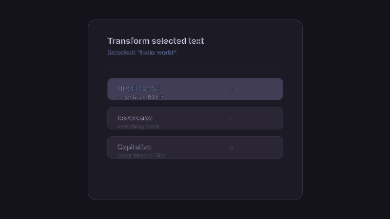

# Text Transform

An [Omarchy](https://omarchy.org/) shell plugin that transforms the text you
have highlighted and replaces it in place. Highlight any text, press
`SUPER + U` (configurable, bound automatically — no editing
`~/.config/hypr/bindings.lua` required), pick **Uppercase**, **Lowercase**,
or **Capitalize**, and the selection is rewritten — no copy–paste bookkeeping.



## Features

- Three case transformations on the highlighted text:
  - **Uppercase** — `everything UPPER`
  - **Lowercase** — `everything LOWER`
  - **Capitalize** — `Every Word In Title Case` (first letter of each word
    uppercase, the rest lowercase; apostrophes like `don't` stay intact)
- Reads the **primary selection** (the live highlight) with the clipboard as a
  fallback, so it works across GTK/Qt apps, editors, and terminals.
- Replaces the selection **in place** by pasting over it with Shift+Insert —
  like a modified copy-paste of what you had highlighted — or type it out /
  copy only, if you prefer.
- Correct Unicode case folding (accents, umlauts, non-Latin scripts) via a
  small Python helper.
- Theme-aware overlay that follows Omarchy's menu surface colors.
- Global shortcut (`SUPER + U` by default) applied automatically and kept in
  sync with Hyprland — change it by right-clicking the bar icon, no manual
  keybinding file to edit.

## Requirements

- Omarchy shell (Quickshell) — this is a first-party manifest plugin
- `wl-clipboard` (`wl-paste`, `wl-copy`)
- `wtype`
- `python3` (for Unicode-safe case conversion)
- `omarchy-notification-send` (falls back to `notify-send`)

All of the above ship with Omarchy by default.

## Installation

From a git URL (recommended):

```bash
omarchy plugin add https://github.com/TheRock892/text-transform --enable
```

Or copy the folder into the user plugins directory and enable it:

```bash
cp -r text-transform ~/.config/omarchy/plugins/text-transform
omarchy plugin enable text-transform
```

Enable only if you skipped `--enable`:

```bash
omarchy plugin enable text-transform
```

The plugin id is `text-transform`; change the `id` field in `manifest.json`
to your own `author.plugin` namespace if you publish it.

## Removal

```bash
omarchy plugin remove text-transform
```

Or disable it without removing the files:

```bash
omarchy plugin disable text-transform
```

## Usage

### With the picker (recommended)

Highlight some text in any application and press `SUPER + U` — bound for you
automatically, no `bindings.lua` editing needed (see
[Changing the shortcut](#changing-the-shortcut)). A small picker opens:

1. n**U**p / Down / mouse hover to choose a mode, Enter to apply;
2. or press **U**, **L**, **C** for Uppercase, Lowercase, Capitalize;
3. `Esc` cancels.

### Changing the shortcut

Right-click the `Aa` bar icon. A menu shows the current shortcut and offers
**Set a new shortcut…** (type the new combination, e.g. `SUPER + SHIFT + U`,
in the prompt that follows) and, while one is set, **Remove the shortcut**.
The change is saved and applied live — no shell restart needed.

Equivalent from a terminal:

```bash
omarchy bar set text-transform shortcut "SUPER + SHIFT + U"
omarchy bar get text-transform shortcut   # see the current value
omarchy bar set text-transform shortcut ""   # remove it
```

With the shortcut removed, manage your own binding instead:

```lua
o.bind("SUPER + U", "Transform text", "omarchy-shell shell toggle text-transform")
```

### Without the picker

Bind the three operations directly in `~/.config/hypr/bindings.lua` — handy
when you only ever use one mode (this is independent of the picker's own
shortcut above):

```lua
o.bind("SUPER + SHIFT + U", nil, "text-transform upcase")
o.bind("SUPER + SHIFT + L", nil, "text-transform downcase")
o.bind("SUPER + SHIFT + C", nil, "text-transform capitalize")
```

## CLI

```
text-transform [--type] [--copy-only] <upcase|downcase|capitalize>
text-transform --get-selection
text-transform --set-shortcut
```

The command reads the highlighted text (primary selection, clipboard as a
fallback), transforms it, copies the result to the clipboard (convenient side
effect), and replaces the selection by pasting it over the highlight with
Shift+Insert — a modified copy-paste of the selection, rather than retyping
it character by character. A desktop notification confirms which mode was
applied (or copied, with `--copy-only`).

| Option | Behaviour |
| --- | --- |
| *(none)* | Paste the transformed text over the selection with Shift+Insert |
| `--type` | Type the result over the selection instead of pasting |
| `--copy-only` | Put the result on the clipboard and stop |
| `--get-selection` | Print the current selection and exit |
| `--set-shortcut` | Show/change/remove the keyboard shortcut (see [Changing the shortcut](#changing-the-shortcut)) |

Run `text-transform --help` for the full help text.

## How it works

1. The overlay's preview is fed by `bin/text-transform --get-selection`,
   which reads the primary selection via `wl-paste --primary` and falls back
   to the clipboard.
2. Picking a mode dismisses the overlay and runs `bin/text-transform <mode>`.
   The script re-reads the selection, converts it with
   `bin/text-transform.py`, copies the result with `wl-copy`, waits
   ~150 ms for the shell to hand focus back, then pastes it in one shot with
   `wtype -M shift -k Insert -m shift` (Shift+Insert). Because the text is
   still selected, the app replaces the whole highlight with the pasted
   result in a single edit, instead of a flood of per-character keystrokes.
3. Empty selections produce a desktop notification instead of a silent no-op.
4. Selections are capped at 64 KiB and each helper process (`wl-paste`,
   `python3`, `wl-copy`, `wtype`) has a 2-second deadline, so an oversized or
   stuck clipboard producer can't hang the picker or balloon memory.
5. `Service.qml` is a headless component (manifest kind `service`) that owns
   the global shortcut. Omarchy's plugin settings (the `shortcut` key here)
   only configure a widget's own behaviour — there's no manifest-level way
   for a third-party plugin to register a system keybinding — so this
   service reads the setting straight out of `~/.config/omarchy/shell.json`
   and applies it itself on every shell start and whenever the setting
   changes. This Omarchy install's Hyprland config is Lua-based
   (`bindings.lua`, `o.bind`), which rejects the legacy `hyprctl keyword
   bind`/`unbind` outright, and `hl.unbind(combo)` removes *every* bind on
   that combo, including ones that aren't ours — so the service instead
   calls Hyprland's own Lua API (`hl.bind`) through `hyprctl eval`, keeps the
   one bind object it creates in a Lua global, and swaps it out by disabling
   that exact object (`handle:set_enabled(false)`, the pattern Hyprland's own
   default config demonstrates) before creating a new one. It never unbinds
   by key combo, so an existing binding that happens to share the same keys
   is left alone.
   Right-clicking the bar icon (or `text-transform --set-shortcut`) opens a
   menu showing the current shortcut with **Set a new shortcut…** and
   **Remove the shortcut**; picking "set" prompts for the new value with
   `omarchy-menu-input` and saves it with
   `omarchy bar set text-transform shortcut <value>`. The service picks up
   the change from the file watch, no restart required.

## Development

```bash
omarchy plugin validate .   # manifest + entry-point checks
./tests/run.sh              # transform and CLI tests
```

Edit any file under the plugin folder and, once installed, the shell
hot-reloads it on save (`omarchy-shell shell rescanPlugins` if needed).

## License

[MIT](LICENSE)